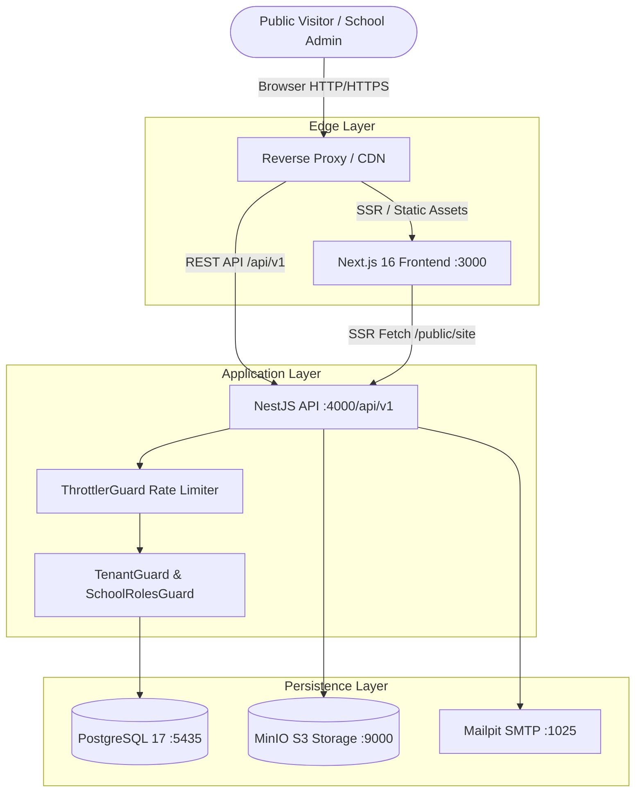

# Master Quality Assurance & Audit Plan
**Project:** Multi-Tenant School Public Profile & Studio Management SaaS Platform  
**System Scope:** SaaS Platform for School Website Publishing & Studio Customization (Strictly Non-ERP/LMS)  
**Lead Auditor:** Senior QA Architect, Full-Stack Engineer, Multi-Tenant Security Auditor, Database Architect, Performance Specialist  
**Document Version:** 1.0.0 (Production Release Gate Audit)  
**Date:** November 2026  

---

## 1. Executive Summary & Audit Mandate

This document establishes the comprehensive Quality Assurance Master Plan for the **School Public Profile & Studio Management SaaS Platform**. The platform provides educational institutions with multi-tenant tools to design, customize, preview, publish, and manage their public-facing websites and online presence without requiring engineering resources.

### 1.1 Strict Project Scope Boundary
In strict adherence to project architecture specifications, this application is **NOT a School Management System (SMS), Learning Management System (LMS), or School Enterprise Resource Planning (ERP)** software.

```
+-------------------------------------------------------------------------------+
|                       SYSTEM BOUNDARY SPECIFICATION                           |
+------------------------------------+------------------------------------------+
|  IN-SCOPE (Tested & Audited)       |  EXPLICITLY EXCLUDED (Zero ERP/LMS)      |
+------------------------------------+------------------------------------------+
| - Multi-tenant school profiles     | - Student management portals             |
| - School Studio Builder & Themes   | - Teacher LMS / grading portals          |
| - Public school websites & pages   | - Homework, assignments, & submissions   |
| - Dynamic notices, events, gallery | - Examinations, report cards, marks      |
| - Faculty directory & bios         | - Attendance management (student/staff)  |
| - Online admission inquiry portal  | - Tuition fee collection & student billing|
| - Custom domains & slug resolution | - Payroll, staff HR, & benefits          |
| - Version snapshots & publishing   | - Library catalog & book borrowing       |
| - SEO, OpenGraph, & analytics      | - Internal student/parent SMS messaging  |
+------------------------------------+------------------------------------------+
```

---

## 2. Platform Architecture Overview

The platform is designed as a decoupled, multi-tenant cloud-native architecture comprising:
1. **Frontend:** Next.js 16 (React 19, Turbopack, Tailwind CSS 4, Radix UI) providing Server-Side Rendered (SSR) public school websites and Client-Side Rendered (CSR) Studio administration.
2. **Backend:** NestJS 11 RESTful API with TypeScript, Passport JWT authentication, global validation pipes, standardized response envelopes, and Throttler rate limiting.
3. **Database:** PostgreSQL 17 managed via Prisma ORM 7 with native pg adapter, strictly enforced foreign keys, cascading deletes, and tenant isolation indexes.
4. **Storage:** MinIO / AWS S3-compatible object storage with presigned upload/download URLs and asset metadata management.
5. **Mailer:** SMTP email integration (Mailpit in test/staging, SendGrid/SES in production) for verification and notification triggers.



---

## 3. Test Strategy & Methodologies

The QA audit follows an empirical, evidence-based verification strategy consisting of six major testing methodologies:

### 3.1 Multi-Tenant Isolation Testing (P0 Critical)
- Validation of strict tenant boundaries using three isolated test schools (School A: `greenwood-academy`, School B: `st-judes-grammar` [Unpublished], School C: `oakridge-prep`).
- Penetration testing against cross-tenant IDOR, direct API manipulation, header spoofing (`x-school-id`), parameter tampering, and draft exposure.
- **Acceptance Criterion:** ZERO unauthorized cross-tenant data access or mutations.

### 3.2 Authentication & Role-Based Access Control (RBAC)
- Validation of platform-level roles (`SUPER_ADMIN`, `ADMIN`, `USER`, `MODERATOR`) versus tenant-level roles (`OWNER`, `ADMIN`, `EDITOR`, `CONTENT_MANAGER`, `ANALYST`).
- Evaluation of JWT token issuance, verification, expiration, refresh rotation, and password reset flows.
- Verification of endpoint authorization boundaries (e.g., School Admin accessing Super Admin endpoints).

### 3.3 Functional & Studio Verification
- Public school profile attributes: Name, logo, banner, motto, bio, principal message, facilities, statistics, contact details, social links.
- Profile Studio capabilities: Template switching (Classic, Modern, Academic, Minimalist), theme customization (colors, fonts, radius), section ordering, draft saving, live previewing, version snapshotting, and publishing.

### 3.4 API Security & Quality Audit
- Complete inspection of all 108 REST endpoints across 23 controllers.
- Negative testing: missing required fields, invalid UUIDs, unexpected types, non-whitelisted payload rejection (`forbidNonWhitelisted: true`).
- Security assessment based on OWASP Top 10 and OWASP API Security Top 10.

### 3.5 Performance, Concurrency & Scalability
- Load testing under simulated high concurrency (50–100 simultaneous requests).
- Measurement of throughput (Requests/sec), latency distribution (Avg, P50, P90, P95, P99), connection pooling stability, and memory/CPU profile.
- Verification of Throttler rate limiting (100 req/min).

### 3.6 Real Browser E2E Automation
- Headless Google Chrome execution (`puppeteer-core`) across Desktop (1920x1080) and Mobile (390x844).
- Verification of DOM rendering, hydration, navigation routing, form submission, and console error monitoring.

---

## 4. Test Environment & Persona Matrix

| Persona / Tenant | Entity Name | Slug / Role | Identifier | Purpose |
|---|---|---|---|---|
| **Super Admin** | Platform Admin | `SUPER_ADMIN` | `superadmin@example.com` | Verify platform-wide governance & user administration |
| **School A Owner** | Greenwood Academy | `OWNER` / Published | `admin@greenwood.edu` | Verify full tenant administration & profile publishing |
| **School A Editor** | Greenwood Academy | `EDITOR` / Published | `editor@greenwood.edu` | Verify restricted editorial role (no unpublish/delete) |
| **School B Owner** | St. Jude Grammar | `OWNER` / Unpublished | `admin@stjudes.edu` | Verify draft isolation & public 404/403 protection |
| **School C Owner** | Oakridge Prep | `OWNER` / Published | `admin@oakridge.edu` | Target tenant for cross-school attack simulations |
| **External Attacker** | No School Affiliation | `USER` / Unaffiliated | `attacker@external.org` | Validate rejection of unauthorized API access |
| **Public Visitor** | Anonymous Web User | Unauthenticated | N/A | Verify public SSR rendering & admission submission |

---

## 5. Production Readiness Acceptance Criteria

The final release decision is governed by binary quality gates:

1. **Gate 1 - Zero Cross-Tenant Leakage:** No authenticated user can access, read, modify, or delete resources belonging to another school tenant.
2. **Gate 2 - Zero Critical Security Vulnerabilities:** No unauthenticated access to protected management endpoints, no SQL injection, no IDOR, and no secret exposure.
3. **Gate 3 - Draft Privacy Guarantee:** Unpublished school profiles and staged draft modifications must never be exposed to public visitors.
4. **Gate 4 - Functional Workflow Completeness:** All core public profile rendering, studio customization, and admission tracking workflows operate deterministically.
5. **Gate 5 - Stable Performance Baseline:** Public SSR and API endpoints must sustain at least 150 RPS with P95 latency under 500ms.
6. **Gate 6 - Reproducible Deployment:** Zero build errors, clean migration deploy, and containerized deployment resilience.

---

## 6. QA Deliverables Index (22 Documents)

1. `QA_MASTER_PLAN.md` - Master test strategy and scope definition (This document).
2. `APPLICATION_MODULE_INVENTORY.md` - Comprehensive repository inventory of modules, APIs, and models.
3. `FUNCTIONAL_TEST_REPORT.md` - Functional test results for school profile and studio features.
4. `TENANT_ISOLATION_REPORT.md` - Multi-tenant isolation testing evidence and IDOR attack probes.
5. `AUTHENTICATION_AUTHORIZATION_REPORT.md` - RBAC, JWT, OTP, and permissions test report.
6. `SECURITY_AUDIT_REPORT.md` - OWASP API security audit and vulnerability findings.
7. `API_TEST_REPORT.md` - Endpoint validation matrix for all 108 REST endpoints.
8. `DATABASE_INTEGRITY_REPORT.md` - PostgreSQL schema, relations, constraints, and migration verification.
9. `PUBLIC_PROFILE_TEST_REPORT.md` - Public visitor rendering, slug resolution, and subroute verification.
10. `STUDIO_TEMPLATE_THEME_TEST_REPORT.md` - Theme customizer, templates, and preview persistence.
11. `FILE_STORAGE_TEST_REPORT.md` - MinIO S3 storage audit, presigned URLs, and access controls.
12. `ADMISSION_INTEGRATION_REPORT.md` - Public online admission submission and anti-enumeration verification.
13. `PUBLIC_SEO_REPORT.md` - SEO metadata, OpenGraph, sitemap, and robots.txt analysis.
14. `UI_UX_TEST_REPORT.md` - Responsive UI layout, accessibility, and browser console inspection.
15. `INTEGRATION_E2E_TEST_REPORT.md` - End-to-end user workflows from onboarding to public visit.
16. `PERFORMANCE_SCALABILITY_REPORT.md` - Concurrency benchmarks, latency percentiles, and load testing.
17. `DEPLOYMENT_RECOVERY_REPORT.md` - Docker configuration, environment readiness, and disaster recovery.
18. `MISSING_FEATURES_GAP_ANALYSIS.md` - Gap analysis of confirmed missing vs. implemented functionality.
19. `BUG_TRACKER.md` - Systematic defect tracker with reproduction steps and remediation guides.
20. `TEST_COVERAGE_REPORT.md` - Automated test suite coverage and execution metrics.
21. `FINAL_PRODUCTION_READINESS_REPORT.md` - Production readiness verdict and release sign-off.
22. `QA_PROGRESS_TRACKER.md` - Live progress tracker and milestone log.
